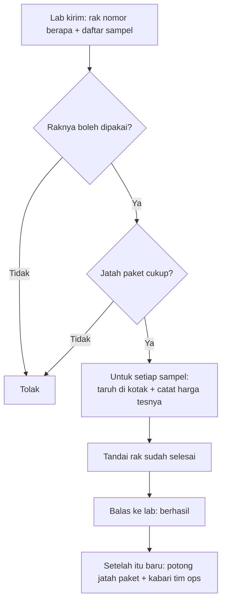
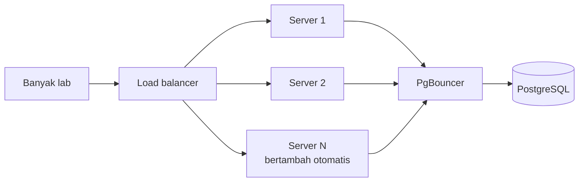

# Tes 1 — Code Review: `culturePoolAssignment.js`

> **Permintaan Produk:** analisa dan keputusan engineering supaya service ini bisa melayani **jumlah lab yang lebih banyak**.

## Apa yang dilakukan kode ini

### Dalam satu kalimat

Lab mengirim beberapa sampel, lalu kode ini **menaruh setiap sampel ke tempatnya**, **mencatat biayanya**, dan **memotong jatah paket** lab tersebut.

### Istilah

Supaya mudah dibaca, istilah di kode saya sebut dengan bahasa sehari-hari:

| Di kode            | Bahasa sehari-hari            |
| ------------------ | ----------------------------- |
| culture pool       | rak                           |
| strain slot        | kotak di dalam rak            |
| isolate            | sampel                        |
| taxonomy call      | tes yang diminta untuk sampel |
| price sheet        | daftar harga tes              |
| subscription quota | jatah paket langganan         |

### Alurnya



### Langkah demi langkah

1. **Cek raknya.** Rak harus ada, tidak dibatalkan, sudah sampai di lab, dan belum pernah diisi. _(Satu rak hanya boleh diisi sekali.)_
2. **Cek jatahnya.** Kalau lab berlangganan, kode memastikan sisa jatahnya cukup. Di sini jatah **hanya dilihat, belum dipotong**.
3. **Isi rak, satu sampel demi satu sampel:**
   - Sampel **bakteri** ditaruh di **kotak pertama** yang masih ada tempat.
   - Sampel **lainnya** ditaruh di **kotak terakhir** yang masih ada tempat.
   - Setiap tes untuk sampel itu dicatat harganya.
   - Kalau ada sampel yang gagal disimpan, sampel itu **dilewati diam-diam** dan proses lanjut ke sampel berikutnya.
4. **Tandai rak selesai,** supaya tidak bisa diisi lagi.
5. **Balas ke lab:** "sekian sampel berhasil".
6. **Baru setelah membalas,** kode memotong jatah paket dan mengirim pesan ke tim ops lewat Slack.

### Hal yang perlu diingat

- Jatah paket **dicek di awal**, tetapi baru **dipotong di akhir, setelah lab menerima balasan**.
- Kalau ada sampel yang gagal, sampel itu **tidak menghentikan proses**. Sampel tersebut hanya dilewati dan dicatat di log.

Dua hal ini akan penting saat kita membahas apa yang terjadi kalau jumlah lab bertambah.

---

## Analisa: supaya service bisa melayani lebih banyak lab

### Kesimpulan

Untuk melayani lebih banyak lab, cara utamanya adalah **menambah server aplikasi** (_horizontal scaling_).
Masalahnya, **kode sekarang belum bisa di-scale**: kalau servernya ditambah, datanya akan rusak.

Jadi rencananya ada dua langkah:

1. **Perbaiki kode supaya aman dijalankan di banyak server.**
2. **Tambah server dan jaga database** sesuai pertumbuhan lab.

---

### Langkah 1 — Apa yang menghalangi scale, dan perbaikannya

| #   | Penghalang di kode sekarang (baris)                                                                                  | Yang terjadi kalau lab bertambah                                                             | Perbaikan                                                                                                |
| --- | -------------------------------------------------------------------------------------------------------------------- | -------------------------------------------------------------------------------------------- | -------------------------------------------------------------------------------------------------------- |
| 1   | Nomor urut (`batchIndex`) disimpan di **memori server** (`:10`, `:149-154`)                                          | Dua server menghasilkan nomor yang sama                                                      | Ambil nomor dari **database** (_sequence_)                                                               |
| 2   | Jatah paket **dicek di awal, dipotong setelah membalas lab** (`:45-53`, `:119`)                                      | Dua rak dari lab yang sama lolos bersamaan, jatah jebol                                      | Potong jatah **di dalam proses**, dengan **kunci per lab**                                               |
| 3   | Status "rak sudah diisi" dicek dan ditandai **terpisah** (`:25`, `:113`)                                             | Klik dua kali → rak terisi dua kali                                                          | **Kunci rak** selama diproses                                                                            |
| 4   | Sampel yang gagal **dilewati**, rak tetap ditandai selesai (`:106-113`)                                              | Saat database sibuk, makin banyak sampel hilang                                              | **Satu transaksi**: berhasil semua, atau batal semua                                                     |
| 5   | Sampel disimpan **satu per satu**, ±1.000 query per permintaan (`:70-111`)                                           | Koneksi database habis, semua lab ikut lambat                                                | **Simpan sekaligus** (±10 query)                                                                         |
| 6   | Notifikasi dikirim **tanpa ditunggu** setelah membalas (`:119`, `:173-182`)                                          | Server mati atau restart → notifikasi hilang                                                 | Tulis ke tabel **outbox**, lalu dikirim oleh worker                                                      |
| 7   | Data sampel (jenis, tes, status) **diambil dari kiriman lab**, dan kepemilikan rak **tidak dicek** (`:13`, `:56-87`) | Makin banyak lab, makin besar risiko satu lab mengubah harga atau mengisi rak milik lab lain | Lab cukup kirim **id sampel**. Data lainnya dibaca dari database, dan rak harus **milik lab yang login** |
| 8   | Satu data rusak bisa membuat **server mati** (error di luar `try`) (`:75`)                                           | Semua lab yang sedang dilayani server itu ikut gagal                                         | **Validasi input di awal** dan tangkap semua error, supaya yang gagal hanya permintaan itu               |

Catatan: kunci di poin 2 dan 3 hanya membuat **lab yang sama** mengantre. Lab yang berbeda tetap berjalan bebas, jadi menambah lab tidak memperlambat lab lain.

#### Inti perbaikannya: proses dibuat atomik di database

Poin 2, 3, 4, dan 6 di atas digabung menjadi **satu transaksi database yang atomik**. Ada dua hal yang dijaga:

- **Atomik:** semua langkah berhasil bersama, atau batal bersama. Tidak ada lagi keadaan setengah jadi.
- **Terkunci:** selama transaksi berjalan, rak dan jatah lab tersebut tidak bisa diubah oleh permintaan lain.

Yang dipakai adalah **kunci per baris** (_row lock_, `FOR UPDATE`), **bukan kunci seluruh tabel**. Hanya rak dan jatah milik lab yang sedang diproses yang terkunci, sehingga lab lain tetap berjalan tanpa menunggu. Kalau yang dikunci seluruh tabel, semua lab harus antre satu per satu, dan sistem justru tidak bisa di-scale.

```sql
BEGIN;
  SELECT ... FROM culture_pools WHERE id = $pool FOR UPDATE;            -- kunci rak
  SELECT ... FROM isolates WHERE id = ANY($ids) ORDER BY id FOR UPDATE; -- kunci sampel
  SELECT ... FROM subscription_packages WHERE lab = $lab FOR UPDATE;    -- kunci jatah lab
  -- cek: rak belum diisi? jatah cukup? harga lengkap?  → kalau tidak: ROLLBACK
  UPDATE subscription_packages SET quota_left = quota_left - 3 ...;     -- potong jatah
  INSERT INTO strain_assignments ...;                                   -- simpan semua sampel sekaligus
  INSERT INTO taxonomy_profiles ...;                                    -- simpan semua harga sekaligus
  UPDATE culture_pools SET assigned_at = now() ...;                     -- tandai rak selesai
  INSERT INTO outbox ...;                                               -- antrekan notifikasi
COMMIT;   -- semua tersimpan bersamaan. Error di mana pun → ROLLBACK, tidak ada yang tersimpan
```

Kenapa **sampel juga dikunci**? Supaya sampel yang sama tidak bisa masuk ke dua rak berbeda di waktu yang sama. Permintaan kedua akan menunggu, lalu melihat sampel itu sudah terpakai dan ditolak dengan pesan yang jelas.

Kenapa tidak bisa **saling tunggu selamanya** (_deadlock_)? Karena urutan mengunci selalu sama: **rak → sampel → jatah**. Ibaratnya semua orang mengantre lewat pintu yang sama, jadi tidak ada yang saling menghalangi.

Sebagai pengaman tambahan, database juga diberi aturan: `quota_left >= 0` (jatah tidak bisa minus), dan satu sampel hanya boleh punya satu assignment. Kalau suatu saat ada bug di kode, database tetap menolak data yang salah.

---

### Langkah 2 — Cara menambah kapasitas



| Tahap                                | Apa                                                                                                          | Kenapa                                                                                     |
| ------------------------------------ | ------------------------------------------------------------------------------------------------------------ | ------------------------------------------------------------------------------------------ |
| **1. Tambah server**                 | Banyak server di belakang load balancer, jumlahnya naik-turun otomatis (_autoscaling_)                       | Setelah Langkah 1, server tidak menyimpan apa pun di memori, jadi bisa ditambah kapan saja |
| **2. Jaga database**                 | **PgBouncer** untuk berbagi koneksi, **index** di tabel jatah dan harga, perbesar mesin database kalau perlu | Kalau server bertambah, yang pertama jadi rebutan adalah database                          |
| **3. Rate limit per lab**            | Batasi jumlah permintaan per lab per menit                                                                   | Satu lab yang sangat ramai tidak menghabiskan kapasitas lab lain                           |
| **4. Kalau angka menunjukkan perlu** | Job queue (permintaan sangat besar), read replica (beban baca tinggi), cache harga                           | Sengaja ditunda, karena menambah kerumitan sebelum dibutuhkan                              |

**Angka yang dipantau** untuk menentukan kapan naik tahap: waktu respons (p95), lama permintaan menunggu kunci, pemakaian koneksi database, dan jumlah permintaan yang ditolak.

---

### Dampaknya (perkiraan, perlu dibuktikan dengan uji beban)

|                                      | Sekarang               | Setelah perbaikan     |
| ------------------------------------ | ---------------------- | --------------------- |
| Bisa dijalankan di banyak server     | ❌                     | ✅                    |
| Waktu 1 permintaan (200 sampel)      | ±1–5 detik             | ±50 ms                |
| Kapasitas dengan 20 koneksi database | ±4–20 permintaan/detik | ±400 permintaan/detik |
| Jatah paket saat ramai               | bisa jebol             | selalu tepat          |

---

### Urutan pelaksanaan

1. **Cek dan rapikan data lama.** Celah ini sudah ada di production, jadi mungkin sudah ada sampel ganda atau jatah yang jebol. Aturan "satu sampel satu assignment" baru bisa dipasang kalau datanya sudah bersih.
2. **Ubah database:** sequence, tabel outbox, aturan pengaman, dan index.
3. **Aktifkan bertahap:** mulai dari beberapa lab, lalu diperluas kalau aman.
4. **Uji beban** sesuai target dari tim Produk, sebelum lab baru masuk.

---

### Perlu diputuskan dengan tim Produk

1. **Jatah dipotong sebelum membalas lab**, bukan di belakang layar seperti alur sekarang. Ini wajib supaya jatah tidak jebol.
2. **Kalau satu sampel bermasalah, seluruh permintaan ditolak** (beserta daftar sampel yang bermasalah), supaya tidak ada sampel yang hilang diam-diam.
3. **Target pertumbuhan:** berapa lab dan berapa permintaan di jam sibuk? Angka ini dipakai untuk uji beban.

---
