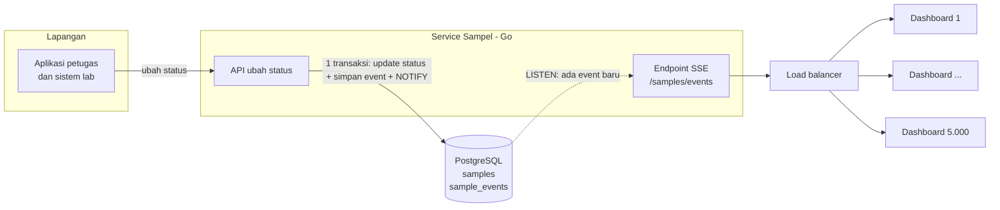
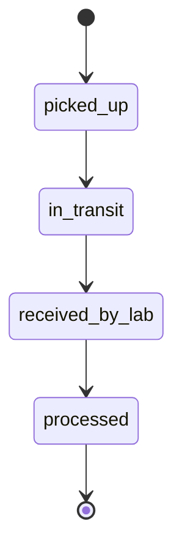
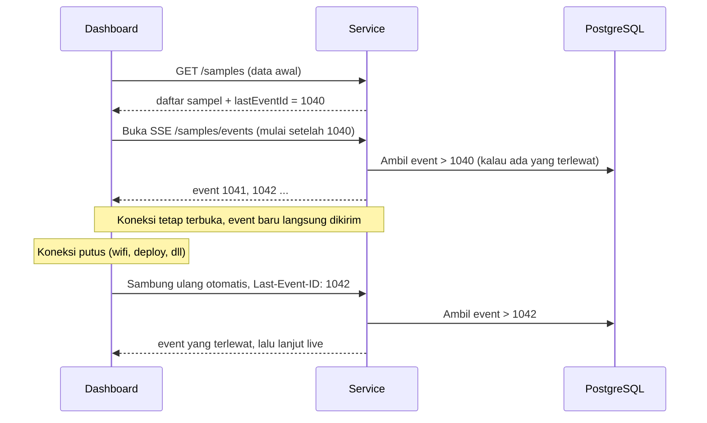

# Tes 2 — Infrastructure Decision: Notifikasi Real-time Status Sampel

> **Untuk:** tim backend, frontend, dan platform yang akan membangun dan menjalankan fitur ini.

## Ringkasan

Dashboard operasional harus langsung berubah setiap kali status sampel berganti, tanpa perlu di-refresh:

```
Diambil  →  Dalam perjalanan  →  Diterima lab  →  Selesai diproses
```

**Keputusan:** memakai **Server-Sent Events (SSE)**, dengan **PostgreSQL** sebagai sumber event sekaligus penyalurnya (`LISTEN/NOTIFY`).

**Alasan singkat:** notifikasinya hanya **satu arah** (server → dashboard), dan SSE memang dibuat untuk itu. SSE berjalan di atas HTTP biasa, sehingga lolos load balancer standar tanpa konfigurasi khusus, dan browser otomatis menyambung ulang kalau koneksi putus. Kami juga **tidak menambah server atau teknologi baru**, karena semuanya memakai database yang sudah ada.

---

## 1. Asumsi

| Hal                      | Asumsi                                                                           | Kalau ternyata berbeda                                                           |
| ------------------------ | -------------------------------------------------------------------------------- | -------------------------------------------------------------------------------- |
| Jumlah dashboard terbuka | ±5.000 di jam sibuk, dirancang untuk 10.000                                      | Desain tetap sama, cukup menambah instance                                       |
| Jumlah perubahan status  | ±10.000 sampel/hari × 4 status ≈ rata-rata 1 event/detik, puncak ±20 event/detik | Kalau mencapai ratusan event/detik, ganti penyalur ke Redis atau NATS (lihat §8) |
| Bahasa backend           | **Go**: satu koneksi SSE cukup ditangani satu goroutine yang ringan              | Node.js juga bisa, dengan pola yang sama                                         |
| Siapa melihat apa        | Petugas hanya melihat sampel milik lab atau wilayahnya                           | Filter disesuaikan                                                               |

---

## 2. Kenapa SSE

| Pilihan                                 | Kelebihan                                                                                                                | Kekurangan                                                                                                                                              | Keputusan                                 |
| --------------------------------------- | ------------------------------------------------------------------------------------------------------------------------ | ------------------------------------------------------------------------------------------------------------------------------------------------------- | ----------------------------------------- |
| **Polling** (cek tiap 5 detik)          | Paling sederhana                                                                                                         | 5.000 dashboard ÷ 5 detik = **1.000 request/detik**, dan hampir semuanya kosong. Masih ada jeda sampai 5 detik.                                         | ❌ Boros, dan tidak benar-benar real-time |
| **WebSocket**                           | Dua arah, sangat populer                                                                                                 | Kemampuan dua arah **tidak dibutuhkan**. Perlu konfigurasi _upgrade_ di load balancer, serta mekanisme heartbeat dan sambung ulang yang dibuat sendiri. | ❌ Lebih rumit tanpa manfaat tambahan     |
| **Layanan pihak ketiga** (Pusher, Ably) | Tidak perlu mengelola sendiri                                                                                            | Ada biaya bulanan, data operasional keluar dari infrastruktur kita, dan bergantung pada vendor                                                          | ❌ Belum perlu untuk skala ini            |
| **Socket.IO**                           | Library populer, sudah menangani sambung ulang                                                                           | Butuh **sticky session** di load balancer dan **Redis adapter** supaya bisa berjalan di beberapa instance. Ada dua komponen tambahan untuk fitur yang hanya satu arah. | ❌ Menambah infrastruktur tanpa kebutuhan |
| **SSE**                                 | HTTP biasa, satu arah, **browser menyambung ulang otomatis**, dan bisa melanjutkan dari event terakhir (`Last-Event-ID`) | Hanya satu arah                                                                                                                                         | ✅ **Sesuai kebutuhan**                   |

**Keputusan ini mudah diubah.** Alur di backend (tabel event → `NOTIFY` → service) tidak bergantung pada protokolnya. Kalau suatu hari dashboard perlu mengirim data balik, yang diganti hanya lapisan terluar (SSE → WebSocket), dan bagian lain tetap sama.

---

## 3. Arsitektur



**Cara kerjanya:**

1. Petugas mengubah status sampel. Dalam **satu transaksi**, service mengubah status, menyimpan event ke tabel `sample_events`, lalu memanggil `NOTIFY`.
2. Setiap instance service sudah `LISTEN` ke database. Begitu transaksi selesai (_commit_), semua instance menerima kabar ada event baru. `NOTIFY` hanya berfungsi sebagai **sinyal**. Isi event diambil dari tabel `sample_events`, sehingga urutannya terjaga dan tidak terkena batas ukuran pesan `NOTIFY`.
3. Setiap instance meneruskan event itu ke dashboard yang terhubung dengannya, **hanya ke yang berhak melihatnya**.

**Kenapa desainnya seperti ini:**

- **Satu transaksi:** event tidak mungkin terkirim untuk perubahan yang batal, dan tidak mungkin hilang untuk perubahan yang berhasil. `NOTIFY` di Postgres memang baru dikirim setelah _commit_.
- **Tabel `sample_events` dipakai untuk tiga hal sekaligus:** riwayat status, sumber data saat dashboard menyambung ulang, dan pemicu notifikasi. Satu sumber kebenaran, tanpa duplikasi.
- **Tidak ada sticky session.** Dashboard boleh terhubung ke instance mana pun, karena semua instance menerima event yang sama dari database.
- **Yang mendengarkan database hanya instance service** (misalnya 3 koneksi), bukan 5.000 dashboard. Beban ke database tetap kecil.

---

## 4. Mengubah status & kalau terjadi error

### Urutan status yang sah

Status hanya boleh **maju satu langkah**. Tidak boleh mundur atau melompat.



| Nilai di API & database | Label di dashboard |
|---|---|
| `picked_up` | Diambil |
| `in_transit` | Dalam perjalanan |
| `received_by_lab` | Diterima lab |
| `processed` | Selesai diproses |

Backend, aplikasi petugas, dan dashboard **wajib memakai nilai yang sama** (kolom kiri). Label hanya untuk tampilan.

### Cara mengubah status

Aplikasi petugas mengirim:

```
POST /samples/{id}/status
{ "to": "in_transit", "version": 2, "requestId": "uuid-dari-aplikasi", "occurredAt": "..." }
```

Server **mengecek `requestId` dulu**, baru menjalankan perubahan dalam **satu transaksi**:

```sql
-- 1. Request ini sudah pernah diproses? (aplikasi melakukan retry)
SELECT ... FROM sample_events WHERE request_id = $requestId;
--    ada → langsung balas 200 dengan hasil yang lama, selesai

-- 2. Belum pernah → proses
BEGIN;
  UPDATE samples SET status = $to, version = version + 1
   WHERE id = $id AND version = $version AND status = $from_yang_sah;  -- 0 baris = ditolak
  INSERT INTO sample_events (..., request_id) VALUES (...);             -- request_id UNIQUE
  NOTIFY sample_events;
COMMIT;   -- gagal di mana pun → ROLLBACK, tidak ada event, dashboard tidak berubah
```

Kenapa `requestId` dicek **sebelum** `UPDATE`? Saat aplikasi retry, `version` sudah naik dari request pertama. Kalau `UPDATE` dijalankan duluan, hasilnya 0 baris dan petugas keliru menerima `409`. Kalau dua retry datang di saat yang benar-benar bersamaan, aturan `UNIQUE` pada `request_id` tetap menangkapnya, dan server membalas `200`.

Kunci utamanya: **event hanya dibuat kalau update berhasil.** Jadi apa pun error yang terjadi, dashboard tidak pernah menampilkan status yang salah.

### Daftar kasus error

| Kejadian                                                               | Penanganan                                                                                                                        | Balasan ke aplikasi petugas                               |
| ---------------------------------------------------------------------- | --------------------------------------------------------------------------------------------------------------------------------- | --------------------------------------------------------- |
| Status melompat atau mundur (misalnya _diambil_ → _selesai_)           | Ditolak sebelum menyentuh data                                                                                                    | `422` "transisi tidak valid"                              |
| Dua pihak mengubah sampel yang sama bersamaan (misalnya kurir dan lab) | Cek `version`: yang datang belakangan tidak cocok, jadi ditolak                                                                   | `409` + status terbaru, aplikasi menampilkan data terbaru |
| Request terkirim dua kali (sinyal jelek, aplikasi retry)               | `requestId` sudah ada → dianggap sukses, **tanpa event ganda**                                                                    | `200` dengan hasil yang sama seperti sebelumnya           |
| Database error atau timeout                                            | Transaksi dibatalkan seluruhnya                                                                                                   | `503`, aplikasi mengulang dengan `requestId` yang sama    |
| Petugas sedang offline di lapangan                                     | Aplikasi menyimpan perubahan di antrean lokal, lalu mengirim **berurutan** saat online, dengan `occurredAt` = waktu kejadian asli | Petugas melihat tanda "menunggu terkirim"                 |
| Sampel tidak ada, atau bukan wewenang petugas itu                      | Ditolak                                                                                                                           | `404` / `403`                                             |

**Kenapa memakai cek `version` (optimistic lock), bukan mengunci baris?** Yang diubah hanya satu baris sampel, dan bentrokan jarang terjadi. Cek `version` cukup satu perintah `UPDATE`, tanpa membuat request lain menunggu.

---

## 5. Alur di sisi dashboard



**Catatan penting untuk backend: replay mundur sedikit.** Id event (`bigserial`) dibuat saat `INSERT`, bukan saat _commit_. Jadi event 1043 bisa selesai lebih dulu daripada event 1042. Kalau dashboard menyambung ulang dari 1043, event 1042 bisa terlewat. Karena itu, saat replay, server mengambil event **mulai sedikit sebelum** `lastEventId` (misalnya 5 detik terakhir). Event yang terkirim dua kali aman, karena frontend mengabaikannya lewat `version`.

**Poin penting untuk frontend:**

- **Ambil data awal dulu, baru buka SSE dari `lastEventId`.** Dengan cara ini tidak ada event yang terlewat di antara keduanya.
- **Penyambungan ulang ditangani browser.** `EventSource` otomatis mengirim `Last-Event-ID`, jadi tidak perlu kode tambahan.
- **Abaikan event yang lebih lama** dari data yang sudah ada (bandingkan `version`). Event bisa terkirim dua kali saat sambung ulang, dan cara ini membuatnya aman.
- **Kalau menerima event `reset`** (koneksi putus terlalu lama dan event sudah dibersihkan), ambil ulang data awal.
- **Cadangan:** kalau SSE gagal terus selama lebih dari 1 menit, dashboard beralih ke polling setiap 30 detik dan menampilkan tanda "mode terbatas".
- **Tampilkan status koneksi:** indikator kecil "Live" atau "Menyambung ulang…", supaya petugas tahu apakah data yang dilihat masih terbaru.

---

## 6. Kontrak event

Format yang dikirim server:

```
id: 1042
event: sample.status_changed
data: {"sampleId":"S-123","labId":"lab-bdg","from":"in_transit","to":"received_by_lab","version":3,"occurredAt":"2026-10-24T09:15:00Z"}
```

Selain itu, server mengirim:

- **`: ping`** setiap **20 detik**, supaya load balancer tidak menutup koneksi yang dianggap diam.
- **`retry: 3000`** untuk mengatur jeda sambung ulang. Saat deploy, nilainya diacak 1–10 detik supaya 5.000 dashboard tidak menyambung ulang di detik yang sama.

Tabel event:

```sql
CREATE TABLE sample_events (
  id          bigserial PRIMARY KEY,   -- dipakai sebagai id event SSE
  sample_id   text NOT NULL,
  lab_id      text NOT NULL,           -- untuk filter hak akses
  from_status text,
  to_status   text NOT NULL,
  version     int  NOT NULL,           -- urutan per sampel
  request_id  text NOT NULL UNIQUE,    -- mencegah event ganda saat aplikasi retry
  occurred_at timestamptz NOT NULL DEFAULT now()
);
-- event disimpan 7 hari, lalu dibersihkan oleh job harian
```

---

## 7. Konfigurasi load balancer & keamanan

| Hal            | Pengaturan                                                     | Kenapa                                                                                                                 |
| -------------- | -------------------------------------------------------------- | ---------------------------------------------------------------------------------------------------------------------- |
| Idle timeout   | Biarkan default (misalnya 60 detik)                            | Ping setiap 20 detik sudah cukup menjaga koneksi                                                                       |
| Buffering      | Matikan untuk path `/samples/events` (`X-Accel-Buffering: no`) | Kalau di-buffer, event tertahan dan tidak real-time                                                                    |
| HTTP/2         | Aktifkan di load balancer                                      | Browser membatasi 6 koneksi HTTP/1.1 per domain, jadi tab ke-7 akan macet                                              |
| Sticky session | **Tidak perlu**                                                | Semua instance setara                                                                                                  |
| Login          | Cookie session `httpOnly`                                      | `EventSource` tidak bisa mengirim header `Authorization`. Token di URL juga tidak dipakai karena bisa tercatat di log. |
| Hak akses      | Filter di server berdasarkan lab atau wilayah user             | Dashboard tidak boleh menerima data lab lain                                                                           |
| Sesi kedaluwarsa | Server menutup setiap koneksi SSE setiap ±15 menit, lalu browser otomatis menyambung ulang | Login dicek ulang secara berkala. User yang sesinya habis atau aksesnya dicabut tidak terus menerima data. |
| Batas koneksi  | Batas koneksi per instance + rate limit per IP di load balancer | Mencegah satu klien menghabiskan kapasitas, tanpa perlu penghitung bersama antar instance |
| Koneksi `LISTEN` | **Langsung ke PostgreSQL**, satu koneksi per instance, **tidak lewat PgBouncer** | `LISTEN` butuh koneksi yang terus terbuka. Lewat PgBouncer (mode transaction), notifikasi tidak akan sampai. |

---

## 8. Kapasitas & kapan perlu diubah

**Perkiraan:**

- 10.000 koneksi × ±20 KB memori per koneksi (Go) ≈ **200 MB**. Kami tetap memakai **minimal 3 instance** supaya kalau satu mati, sisanya masih sanggup.
- Puncak 20 event/detik × dikirim ke dashboard yang relevan → jumlah data kecil, ±beberapa MB/detik.

**Kapan desain ini perlu ditingkatkan:**

| Kalau...                                                                             | ...maka                                                                                                                                      |
| ------------------------------------------------------------------------------------ | -------------------------------------------------------------------------------------------------------------------------------------------- |
| Event mencapai ratusan per detik, atau ada service lain yang juga menghasilkan event | Ganti `LISTEN/NOTIFY` dengan **Redis Pub/Sub atau NATS**. Karena pengiriman event dibungkus satu _interface_, yang berubah hanya bagian itu. |
| Koneksi SSE mengganggu deploy atau autoscaling service utama                         | Pisahkan endpoint SSE menjadi **service gateway** tersendiri                                                                                 |
| Koneksi mendekati 50.000+                                                            | Tambah instance gateway, lalu tinjau ulang batas koneksi di load balancer                                                                    |

---

## 9. Kalau pengiriman ke dashboard gagal

Error saat _mengubah_ status dibahas di §4. Bagian ini membahas error saat _mengirim_ event ke dashboard.

| Kejadian                           | Yang terjadi                                                                                                | Dampak ke petugas                |
| ---------------------------------- | ----------------------------------------------------------------------------------------------------------- | -------------------------------- |
| Satu instance mati                 | Dashboard menyambung ulang ke instance lain, lalu event yang terlewat dikirim ulang                         | Jeda beberapa detik              |
| Koneksi `LISTEN` ke database putus | Instance menyambung ulang, lalu mengambil event setelah id terakhir yang ia kirim                           | Jeda beberapa detik              |
| Deploy                             | Koneksi ditutup perlahan, dengan `retry` yang diacak                                                        | Tidak terasa                     |
| Internet petugas putus lama        | Saat kembali, event yang terlewat dikirim. Kalau sudah lebih dari 7 hari, dashboard memuat ulang data awal. | Data tetap lengkap               |
| SSE gagal total                    | Dashboard beralih ke polling 30 detik                                                                       | Lebih lambat, tetapi tetap jalan |

---

## 10. Yang dipantau

- Jumlah koneksi SSE aktif per instance
- **Jeda pengiriman:** waktu dari perubahan status sampai event terkirim (target p95 < 2 detik)
- Jumlah sambung ulang per menit (lonjakan berarti ada masalah jaringan atau load balancer)
- Jumlah event `reset` dan jumlah dashboard yang jatuh ke mode polling
- Jumlah update status yang ditolak (`409`, `422`) dan yang gagal (`503`). Lonjakan `409` berarti banyak bentrokan, sedangkan lonjakan `422` biasanya berarti ada bug di aplikasi petugas.

---

## 11. Pembagian tugas

| Tim                  | Tugas                                                                                                                                                                                                                                                                                                                                                                                                         |
| -------------------- | ------------------------------------------------------------------------------------------------------------------------------------------------------------------------------------------------------------------------------------------------------------------------------------------------------------------------------------------------------------------------------------------------------------- |
| **Backend**          | Endpoint `POST /samples/{id}/status`: validasi urutan status, cek `version`, dan `requestId` untuk mencegah dobel (§4). Tabel `sample_events`. Menyimpan event + `NOTIFY` dalam satu transaksi. Endpoint `GET /samples` (mengembalikan `lastEventId`) dan `GET /samples/events` (SSE: replay mundur sedikit, live, ping, filter hak akses, tutup koneksi tiap ±15 menit). Interface `EventPublisher` agar penyalur bisa diganti. Job pembersih event lama. |
| **Aplikasi petugas** | Membuat `requestId` sekali per perubahan, dan memakai ulang id yang sama saat retry. Antrean lokal saat offline, dikirim berurutan. Menangani `409` dengan menampilkan status terbaru.                                                                                                                                                                                                                        |
| **Frontend**         | Memuat data awal lalu membuka `EventSource` dari `lastEventId`. Mengabaikan event lama berdasarkan `version`. Menangani event `reset`. Cadangan polling + tanda "mode terbatas". Indikator "Live" / "Menyambung ulang…".                                                                                                                                                                                                                              |
| **Platform**         | Load balancer: HTTP/2, matikan buffering di path SSE, rate limit per IP. Minimal 3 instance. Koneksi `LISTEN` langsung ke Postgres (tidak lewat PgBouncer). Dashboard metrik di §10.                                                                                                                                                                                                                                                                                                            |

**Peluncuran:** aktifkan dengan _feature flag_ untuk satu wilayah dulu. Uji beban dengan 10.000 koneksi palsu, lalu buka untuk semua.

---

## 12. Pertanyaan terbuka

Hal-hal ini perlu dikonfirmasi sebelum atau selama pembangunan. Asumsi sementara ada di §1.

1. **Siapa boleh melihat sampel apa?** Per lab, per wilayah, atau ada peran pusat yang melihat semuanya?
2. **Apakah aplikasi petugas lapangan sudah ada?** Kalau sudah, apakah sudah punya antrean offline dan `requestId`?
3. **Berapa lama riwayat status perlu disimpan?** Rencana awalnya 7 hari untuk replay. Kalau dibutuhkan untuk audit, riwayat dipindah ke arsip.
4. **Berapa angka sebenarnya** untuk jumlah sampel per hari dan dashboard di jam sibuk? Angka ini dipakai untuk uji beban.

---

## 13. Prinsip yang dipakai

- **KISS:** SSE adalah HTTP biasa. Tidak ada protokol baru, dan tidak ada konfigurasi khusus di load balancer.
- **YAGNI:** tanpa Kafka, Redis, Socket.IO, atau layanan pihak ketiga, karena Postgres sudah cukup untuk skala ini. Jalur upgrade sudah disiapkan, tetapi belum dibangun.
- **DRY:** satu tabel `sample_events` dipakai untuk riwayat, sambung ulang, dan notifikasi. Satu daftar nilai status dipakai oleh semua tim.
- **Single Responsibility:** API status hanya mencatat perubahan. Endpoint SSE hanya mengirim. Dashboard hanya menampilkan.
- **Dependency Inversion:** pengiriman event dibungkus interface `EventPublisher`, sehingga mengganti Postgres ke Redis atau NATS tidak mengubah logika bisnis.
