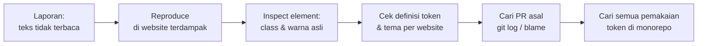

# Tes 3 — One Shot Situation: Token `text-text-primary`

## Ringkasan

Masalahnya ada pada **nama token yang kurang tepat**: `text-text-primary` terdengar seperti "warna teks utama", padahal isinya **warna brand**. Kesalahan yang sama hampir pasti akan terulang oleh orang lain kalau namanya tidak diperbaiki.

Langkah saya sebagai lead:

1. **Hotfix (segera):** perbaiki teks yang tidak terbaca di website yang terdampak.
2. **Dalam 1 minggu:** cari semua pemakaian yang salah, **analisa dampaknya dulu**, lalu baru ubah token `text-text-primary`.
3. **Ke depan:** **ESLint token yang wajib lolos di pipeline**, supaya kesalahan seperti ini tertangkap sebelum di-merge, bukan dua minggu kemudian oleh tim non-teknis.
4. **Dokumentasi cara memakai token yang benar di UI:** fungsi setiap token, kapan dipakai dan kapan **tidak**, serta contoh tampilan benar dan salah. Developer, termasuk junior, tidak perlu lagi menebak dari nama token.

---

## 1. Severity

**Tingkat: Tinggi (P1), diperbaiki hari ini.**

| Aspek                   | Penilaian                                                                                                          |
| ----------------------- | ------------------------------------------------------------------------------------------------------------------ |
| Dampak ke pengguna      | Teks hampir tidak terbaca, sehingga pengguna **tidak bisa membaca konten** halaman itu                             |
| Jangkauan               | Satu website di production, halaman baru                                                                           |
| Data atau keamanan      | Tidak ada data yang rusak atau bocor                                                                               |
| Aksesibilitas           | Gagal standar kontras WCAG (minimal 4.5:1 untuk body text). Pengguna dengan gangguan penglihatan paling terdampak. |
| Bisa dipakai sementara? | Tidak. Pengguna tidak punya cara membaca teksnya.                                                                  |

**Naik ke P0 (darurat)** kalau halaman itu bagian dari alur penting, misalnya form pendaftaran, pembayaran, atau informasi kesehatan, atau kalau trafiknya besar.

**Ukur dampaknya, jangan ditebak:** cek analytics untuk melihat berapa kunjungan ke halaman itu selama dua minggu terakhir, dan apakah bounce rate-nya naik. Angka ini menentukan apakah tingkatnya tetap P1 atau naik ke P0.

**Yang juga perlu dicatat:** masalah ini sudah ada di production **dua minggu** dan ditemukan oleh tim non-teknis, bukan oleh sistem kita. Celah deteksi ini sama pentingnya dengan bug-nya sendiri.

---

## 2. Cara trace isu



1. **Reproduce dulu.** Halaman mana, di website mana, dan apakah ada kondisi khusus (dark mode, browser tertentu)? Ambil screenshot sebagai bukti.
2. **Inspect element.** Lihat class yang dipakai (`text-text-primary`) dan warna yang benar-benar tampil di browser.
3. **Cek definisi token.** Telusuri: `text-text-primary` → `brand.primary` → nilai warnanya **di tema setiap website**. Dugaan saya: website yang terdampak punya warna brand yang **mirip dengan warna background-nya**. Di website lain teksnya masih **terbaca, tetapi tetap salah warna** (body text berwarna brand). Itu sebabnya reviewer tidak melihat ada yang aneh.
4. **Cek apakah halamannya dipakai bersama.** Kalau halaman baru itu ditampilkan di beberapa website dalam monorepo, dampaknya lebih luas dari yang dilaporkan: satu website tidak terbaca, dan yang lain salah warna.
5. **Cari asal perubahan.** `git log -S "text-text-primary"` dan `git blame` untuk menemukan PR-nya. Cek juga **riwayat file tema** website itu. Bisa jadi warna brand-nya baru berubah setelah PR di-merge, yang berarti penyebabnya ada dua.
6. **Cari semua pemakaian.** `rg "text-text-primary"` di seluruh monorepo, sebagai bahan untuk langkah berikutnya.

---

## 3. Extensive review

| Yang diperiksa                          | Pertanyaan                                                                                     | Cara                                                                                              |
| --------------------------------------- | ---------------------------------------------------------------------------------------------- | ------------------------------------------------------------------------------------------------- |
| **Semua pemakaian token ini**           | Mana yang memang untuk warna brand (judul, link), dan mana yang salah dipakai untuk body text? | Daftar hasil `rg`, lalu cek satu per satu × semua tema website                                    |
| **Semua kombinasi warna di semua tema** | Apakah ada pasangan teks dan background lain yang kontrasnya juga gagal?                       | Script kecil yang menghitung kontras setiap token teks terhadap setiap token background, per tema |
| **Token lain yang namanya menyesatkan** | Apakah ada token lain yang namanya tidak menggambarkan isinya?                                 | Review daftar token bersama tim design system                                                     |
| **Proses**                              | Kenapa lolos review, dan kenapa baru ketahuan dua minggu kemudian?                             | Retro singkat dengan engineer dan reviewer                                                        |

**Temuan yang saya perkirakan dari sisi proses:**

- Reviewer hanya mengecek **satu website atau tema**, padahal monorepo-nya punya beberapa website berbeda.
- **Tidak ada pengecekan otomatis** untuk kontras warna atau tampilan per tema (eslint).
- **Belum ada dokumentasi token** yang menjelaskan kapan token boleh dipakai dan kapan tidak.

---

## 4. Mitigasi

### Hotfix — hentikan dampaknya

- Ganti body text di halaman itu ke **token teks netral** (misalnya `text-default`), lalu deploy.
- **Jangan mengubah isi token `text-text-primary` secara global.** Token itu juga dipakai dengan benar di tempat lain (judul, link berwarna brand). Kalau diubah, tempat-tempat itu justru ikut rusak.
- **Pastikan perbaikannya benar-benar berhasil:** cek kontras dengan tool (minimal 4.5:1) di **semua tema**, minta pelapor mengonfirmasi, dan tambahkan satu tes visual untuk halaman ini supaya tidak rusak lagi.

### Dalam 1 minggu — perbaiki sumber masalahnya

#### a. Analisa dampak dulu, baru ubah token

Token `text-text-primary` memang harus diubah, tetapi token ini dipakai di banyak tempat dan banyak website. Kalau langsung diubah, tampilannya bisa berubah di mana-mana. Jadi **ukur dulu dampaknya**:

1. **Hitung pemakaiannya** per website atau package: `rg -c "text-text-primary"`.
2. **Kelompokkan setiap pemakaian:** memang untuk warna brand (judul, link, tombol) atau salah dipakai untuk body text?
3. **Bandingkan screenshot** semua website × semua tema untuk setiap opsi di bawah, supaya terlihat apa saja yang berubah.

Dari hasil analisa itu, pilih salah satu opsi:

| Opsi                                                                           | Dampak                                                                                                   | Dipilih kalau...                                                                |
| ------------------------------------------------------------------------------ | -------------------------------------------------------------------------------------------------------- | ------------------------------------------------------------------------------- |
| **A. Ubah isi token menjadi warna teks netral** (nama tetap)                   | Semua pemakaian brand yang benar ikut berubah menjadi warna netral, sehingga **banyak tampilan berubah** | Mayoritas pemakaiannya ternyata memang body text                                |
| **B. Ganti nama menjadi `text-brand`** + alias _deprecated_ + migrasi bertahap | **Tidak ada tampilan yang berubah.** Migrasinya bertahap dan aman.                                       | Mayoritas pemakaiannya memang warna brand (dugaan saya, opsi ini yang terpilih) |

Apa pun opsinya, **body text yang salah dipindahkan dulu ke token netral**. Setelah itu, sisa pemakaian dimigrasi dengan **codemod** (script cari-ganti otomatis). Nama baru disepakati bersama designer, dan nama lama dihapus setelah tidak ada lagi yang memakainya.

#### b. ESLint untuk token, wajib lolos di pipeline

Aturan token harus dicek oleh mesin, bukan bergantung pada ingatan developer atau ketelitian reviewer.

```js
// eslint.config.js (plugin kecil buatan internal)
rules: {
  'design-tokens/no-deprecated-token':        'error', // text-text-primary → "pakai text-brand"
  'design-tokens/no-brand-color-on-body-text': 'error', // token brand dipakai di <p> atau <Text variant="body">
  'design-tokens/no-raw-color':                'error', // #hex, rgb(), text-[#...] → wajib pakai token
}
```

- **Daftar token dibaca langsung dari file token** design system, jadi tidak ada daftar kedua yang harus disinkronkan secara manual (DRY).
- **Setiap pesan error menyertakan link** ke halaman dokumentasi token yang relevan, supaya developer langsung tahu harus memakai token apa.
- **Berjalan di pipeline CI** (`eslint --max-warnings=0`) sebagai _required check_. Kalau ada pelanggaran, **pipeline gagal dan PR tidak bisa di-merge**.
- **Diterapkan bertahap supaya tim tidak terblokir:** untuk kode baru atau yang diubah, langsung `error`. Untuk kode lama, `warning` sampai migrasi selesai, lalu dinaikkan menjadi `error`.

#### c. Dokumentasi design system yang jelas, khusus token

Junior memilih token hanya dari namanya karena **tidak ada dokumentasi yang bisa ia cek**. Untuk setiap token, dokumentasinya harus berisi:

| Isi                     | Contoh untuk `text-brand`                                              |
| ----------------------- | ---------------------------------------------------------------------- |
| Fungsi                  | Warna brand untuk teks yang perlu menonjol                             |
| Pakai untuk             | Judul, link, label tombol sekunder                                     |
| **Jangan untuk**        | Body text atau paragraf, gunakan `text-default`                        |
| Tampilan di setiap tema | Contoh warna di semua website, berdampingan                            |
| Kontras                 | Nilai kontras terhadap setiap background, dengan tanda ✅ atau ❌ WCAG |
| Contoh kode             | `<h2 className="text-brand">`                                          |

- Halaman ini **dibuat otomatis dari file token** (misalnya di Storybook), sehingga dokumentasi tidak pernah tertinggal dari kode.
- Halaman ini menjadi bacaan wajib di **onboarding** engineer frontend, dan link-nya ada di setiap pesan error ESLint.

#### d. Aturan penamaan token: nama menjelaskan fungsi, bukan warna

`text-text-primary` membingungkan karena dua hal: kata **`text` diulang** (prefix `text-` di Tailwind sudah berarti warna teks), dan kata **`primary` ambigu** (warna teks utama, atau warna brand utama?).

**Aturannya:** `text-{fungsi}`. Nama token harus menjawab pertanyaan _"kapan saya memakai ini?"_, sehingga junior bisa memilih token yang benar tanpa harus membuka dokumentasi.

| Token                                           | Fungsi                                                  |
| ----------------------------------------------- | ------------------------------------------------------- |
| **`text-default`**                              | Body text dan paragraf. **Kalau ragu, pakai ini.**      |
| `text-muted`                                    | Teks pendukung: keterangan, waktu, petunjuk             |
| `text-disabled`                                 | Teks di elemen yang tidak aktif                         |
| **`text-brand`**                                | Teks berwarna brand yang perlu menonjol, misalnya judul |
| `text-link`                                     | Link                                                    |
| `text-on-brand`                                 | Teks **di atas** background warna brand                 |
| `text-inverse`                                  | Teks di atas background gelap                           |
| `text-danger` / `text-success` / `text-warning` | Pesan status                                            |

Hindari kata `primary` dan `secondary`. Nomor varian (misalnya `text-brand-2`) baru ditambahkan kalau memang ada warna brand kedua (YAGNI).

#### e. Panduan memakai token yang benar di UI

Selain dokumentasi per token, developer juga butuh panduan dari sudut pandang yang berlawanan: **"saya sedang membuat elemen X, token apa yang harus dipakai?"**

| Elemen UI                             | ✅ Pakai                                                   | ❌ Jangan                                 |
| ------------------------------------- | ---------------------------------------------------------- | ----------------------------------------- |
| Paragraf / body text                  | `text-default`                                             | `text-brand`, warna `#hex`                |
| Keterangan kecil, waktu, hint         | `text-muted`                                               | `text-default` dengan opacity             |
| Judul halaman atau section            | `text-default` (atau `text-brand` kalau desain memintanya) | —                                         |
| Link                                  | `text-link`                                                | `text-brand`                              |
| Label tombol utama (background brand) | `text-on-brand`                                            | `text-default`, karena bisa tidak terbaca |
| Pesan error form                      | `text-danger`                                              | warna merah `#hex`                        |

- Setiap baris dilengkapi **contoh tampilan benar dan salah** (screenshot berdampingan) di semua tema, supaya terlihat jelas akibatnya kalau salah memilih.
- Panduan ini diletakkan di halaman yang sama dengan dokumentasi token (bagian c), dan menjadi **acuan reviewer** saat mengecek PR UI.

### Ke depan — supaya tidak terulang

| Pengaman                                                                                                                                           | Menangkap apa                                                                       |
| -------------------------------------------------------------------------------------------------------------------------------------------------- | ----------------------------------------------------------------------------------- |
| **Tes kontras otomatis di CI** untuk semua pasangan token × semua tema                                                                             | Kombinasi warna yang tidak terbaca, sebelum di-merge                                |
| **Visual regression per website atau tema** (screenshot otomatis, misalnya dengan Playwright)                                                      | Perubahan tampilan di website yang tidak dicek reviewer                             |
| **Checklist PR untuk perubahan UI:** "sudah dicek di semua tema?"                                                                                  | Review visual yang hanya sekilas                                                    |
| **`CODEOWNERS` untuk file token**, sehingga setiap perubahan token wajib direview pemilik design system                                            | Perubahan token tanpa sepengetahuan pemiliknya                                      |
| **Audit aksesibilitas terjadwal di production** (axe atau Lighthouse per website, setiap minggu) + **kanal lapor yang mudah** untuk tim non-teknis | Masalah yang lolos CI. Tujuannya supaya tidak perlu dua minggu lagi untuk ketahuan. |

**Tidak semuanya dikerjakan sekaligus.** Prioritas pertama adalah **ESLint token di pipeline + dokumentasi token** (bagian b dan c di atas), karena paling murah dan langsung menutup celah ini. Tes kontras, visual regression, dan audit production menyusul setelahnya.

### Komunikasi

- **Saat masalah dikonfirmasi:** kabari tim Produk, designer, pemilik website terdampak, dan tim yang melapor. Sampaikan apa masalahnya, dampaknya, dan kapan perbaikan akan selesai.
- **Setelah hotfix:** kabari bahwa masalah sudah beres, dan terima kasih kepada pelapor. Mereka yang menemukan masalah ini.
- **Dalam 2–3 hari:** tulis **postmortem blameless** yang singkat: kronologi, akar masalah, kenapa lolos, dan daftar aksi. Bagikan ke seluruh tim frontend supaya semua belajar dari kejadian yang sama.

### Rencana aksi

| Aksi                                                   | Penanggung jawab                     | Target   |
| ------------------------------------------------------ | ------------------------------------ | -------- |
| Hotfix halaman + verifikasi di semua tema              | Junior engineer, pairing dengan lead | ASAP     |
| Extensive review + perbaiki semua pemakaian yang salah | Frontend engineer                    | 1 minggu |
| Analisa dampak perubahan token + pilih opsi A/B        | Pemilik design system + designer     | 1 minggu |
| ESLint token di pipeline (mode bertahap)               | Frontend engineer                    | 1 minggu |
| Dokumentasi token + panduan pemakaian token di UI      | Pemilik design system                | 2 minggu |
| Ubah token + codemod sesuai opsi terpilih              | Pemilik design system                | 2 minggu |
| Postmortem                                             | Lead                                 | 2–3 hari |
| Tes kontras di CI                                      | Frontend engineer                    | 2 minggu |
| Visual regression + audit production                   | Frontend / platform                  | 1 bulan  |

---

## 5. Asumsi

- Monorepo berisi **beberapa website dengan tema berbeda**, dan warna brand tiap website berbeda.
- Token didefinisikan terpusat (misalnya Tailwind config atau CSS variables) dan dipakai lewat class seperti `text-text-primary`.
- Di website yang terdampak, warna brand **mirip dengan warna background**. Di website lain kontrasnya cukup, sehingga teksnya terbaca (walaupun tetap salah warna) dan terlihat normal saat review.
- Ada **pemilik design system** (tim atau orang tertentu) dan designer yang bisa dilibatkan. Kalau tidak ada, lead mengambil peran itu sementara.
- Token `text-text-primary` juga **dipakai dengan benar** di tempat lain, sehingga tidak bisa diubah begitu saja.
- **Sudah ada token teks netral.** Kalau belum ada, token itu dibuat sebagai bagian dari hotfix.
- Saat ini **belum ada** tes kontras atau visual regression di CI.
